# figure-docs 向け svg-gen 機能の優先度分類

2026-11-27。[figure-docs の参照図を svg-gen で描いたときの不足機能](./figure-docs-svg-gen-audit.md)の続き。
`business.html` 112 図と `dev.html` 38 図を対象に、不足しているもの・欲しいものを
**必須級 / あれば嬉しい / 最悪なくても頑張れる** に分けた。

ここでの基準は「upstream の SKILL 作者なら全部使いたいはず」ではなく、
svg-gen の核心である **座標を二重に書かせない・関係を自動で保つ・lint で検査する**
をどれだけ損なうかである。`.mbtx` はコードなので、単純な繰り返しや座標の足し算で
済むものは優先度を下げる。逆に、制御点・矢印・text baseline のような幾何計算を
書き手へ戻してしまうものは優先度を上げる。

## 分類の意味

- **必須級**: raw な `d` 文字列や手動の微調整に戻る、または誤配置が起きやすい。
  svg-gen を使う意味そのものが薄れるもの。
- **あれば嬉しい**: primitive と loop で書けるが、図族ごとの一貫性・再利用性・
  見た目の質が大きく上がるもの。
- **最悪なくても頑張れる**: 出現頻度が低い、アルゴリズムが大きい、または
  ライブラリ本体ではなく利用側 template として持てばよいもの。

各表の thumbnail は、`tools/svg-gen/examples/figure-docs/` の写経 probe から
生成した SVG を代表図ごとに並べたもの。upstream の参照図に合わせた固定の
light theme なので、svg-gen の推奨配色の例ではない。

## 必須級

| 機能 | 代表図 | なぜ必須か | TODO に乗せるなら |
| --- | --- | --- | --- |
| typed curve/path builder + curve-aware lint | 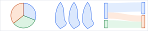 Pie / Violin / Sankey | 現状は C/S/Q/A を raw な `d` 文字列で書く。制御点と bounds の両方を人間/LLM が管理するので、svg-gen の前提を崩す。pie/donut/arc/violin/sankey/chord/cumulative curve に効く。 | `PathBuilder`（move/line/cubic/quadratic/arc/close）、control point を含む bounds 推定、`check.mbtx` の curve command 対応 |
| connector / arrowhead / port / edge label | 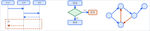 Sequence / Flowchart / Dependency graph | dev references では 27/38 図が polygon を使い、その多くは closed arrowhead。線の向き・接続位置・head の自動追従がないと、概念図の中心機能が手作業になる。 | closed triangle head、orthogonal elbow、shape edge 上の port、connector 上の label anchor |
| baseline-aware text measurement / placement | 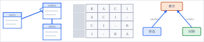 ER / RACI / Requirement | `text(x, y)` の y は baseline、`below(shape, gap)` は shape 下端の y。下側 label が食い込みやすい。text は全図に横断するので、表や dense diagram では致命的。 | text block bbox、baseline を理解する above/below/right/left placement、shape/edge label helper |
| basic chart builder（bar/column/area/pie） | 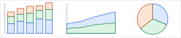 Stacked column / Area / Pie | business references の差・順位・時間・内訳・大きさに繰り返し出る。棒の積み上げや面積、pie slice を毎回手組みするとデータと座標の対応が崩れやすい。 | column/bar（grouped/stacked/diverging）、area/band、pie/donut slice builder |

## あれば嬉しい

| 機能 | 代表図 | なぜ嬉しいか | TODO に乗せるなら |
| --- | --- | --- | --- |
| group / transform / composition / small multiples | 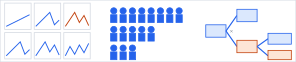 Small multiples / Isotype / KPI tree | loop で書けるので必須ではないが、同じ部品を local coordinate で再利用できると図が読みやすい。small multiples や pictogram で効く。 | translate できる group、node の再利用、簡単な grid layout |
| semantic dev-diagram helper | 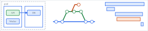 Deployment / Git graph / Trace | sequence/ER/deployment/git/trace の雛形があると、dev.html 系の多くが一気に書きやすくなる。ただし connector/table/text の土台の上に作るべき。 | sequence lifeline、ER entity/crow's foot、lane、flame/span layout から順に |
| theme-aware color scale / semantic color | 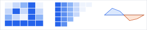 Heatmap / Cohort / Surplus-deficit | categorical 6色だけでは heatmap、positive/negative、確からしさ表現が弱い。ただし写経や最小図では literal color で済む。 | sequential/diverging scale、positive/negative/neutral role、dark theme 対応の色 role |
| table / grid / lane layout | 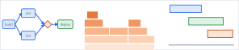 CI/CD / Flame graph / Roadmap | RACI、比較表、gantt、pipeline、flame graph、timing diagram に効く。rect loop で頑張れるが、列幅・row高・lane・cell text を揃える helper があると強い。 | table/grid、列幅と cell padding、lane layout、time axis helper |
| extended chart primitive | 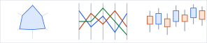 Radar / Parallel coordinates / Stock | radar、parallel、bullet、OHLC、slope、lollipop、violin などを図種として再利用できる。個々は primitive で書けるので、basic chart より後でよい。 | 図種ごとに独立 PR で足す。最初は radar/parallel ではなく利用頻度を見て選ぶ |
| rich text（bold/wrap/partial styling） | Requirement diagram、比較表、framework 図 | 1文字ごとに `text` を置けば逃げられるが面倒。説明文を入れる図では欲しい。 | font weight、multi-line block、inline span、wrapping |

## 最悪なくても頑張れる

| 機能 | 代表図 | なぜ後回しでよいか | 扱い |
| --- | --- | --- | --- |
| geographic map / cartogram / contour | 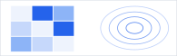 Choropleth / Contour | geo data や contour algorithm が本題になり、svg-gen 本体の責務が大きく膨らむ。小さな schematic map は polygon/path で頑張れる。 | 本体には入れず、外部 data -> primitive 変換の例だけ用意する |
| network / sankey / chord の自動 layout | 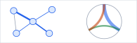 Network / Chord | ribbon や curve の描画機能は必須だが、ノード配置・交差削減・flow allocation は別の大きい問題。小さい図なら手配置で済む。 | 自動 layout は TODO に入れない。必要なら別調査 |
| business framework template | 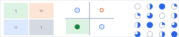 SWOT / Ansoff / Harvey ball | SWOT、PEST、7S、BMC などは構造が固定的で、text/table/group があれば利用側 template として書ける。本体が全 framework を知る必要はない。 | skill 側や examples 側の template として育てる |
| rare/specialized chart | 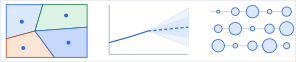 Voronoi / Fan / Circle timeline | Voronoi、fan chart、seismogram、circle timeline などは出現頻度と汎用性が低い。必要になったものだけ primitive 組み合わせで足せる。 | TODO には入れず、要求駆動で追加する |

## 図の類型の全体感

upstream の分類は business 9 類・dev 9 類。すべてを本体に入れると大きすぎるので、
上の表では「仕組み」は本体へ、「図種の雛形」は利用側または別レイヤへ寄せる。

business references（112図）の内訳

- 差（6）: Diverging bar、Diverging stacked bar、Spine chart、Surplus/deficit filled line、Bullet chart、Tornado chart
- 相関（6）: Scatterplot、Line + Column、Connected scatterplot、Bubble、XY heatmap、BCG matrix
- 順位（7）: Ordered bar/column/proportional symbol、Dot strip plot、Slope、Lollipop chart、Pareto chart
- 分布（9）: Histogram、Boxplot、Violin、Population pyramid、Dot strip/dot/barcode plot、Cumulative curve、Football field
- 時間での変化（17）: Line/Column/Line+column/Stock/Slope/Area/Fan/Connected scatter/Calendar heatmap/Priestley/Circle timeline/Seismogram/Cohort heatmap/Sparkline/Small multiples/普及曲線/製品ライフサイクル
- 内訳（12）: Stacked/proportional bar、Pie、Donut、Treemap、Voronoi、Arc、Gridplot、Venn、Waterfall、Marimekko、KPIツリー
- 大きさ（10）: Column/Bar、Paired column/bar、Proportional stacked bar/symbol、Isotype、Lollipop、Radar、Parallel coordinates
- 地理（8）: Choropleth、Proportional symbol、Flow map、Contour、Cartogram 2種、Dot density、Heat map
- 流れ（4）: Sankey、Waterfall、Chord、Network
- 数が無い論点（33）: 2x2、ポジショニング、ツリー/ピラミッド/入れ子/枠組み、プロセス/漏斗/旅程/スイムレーン/ロードマップ、関係・因果・比較表・SWOT・RACI・BMC・ハーベイボールなど

dev references（38図）の内訳

- 構造（9）: System Context、Container、Component、Layer、Dependency graph、Class、Context Map、Wardley map、部品と関心事の表
- やりとり（3）: Sequence、Dynamic、Event storming
- 状態と手順（5）: State machine、Flowchart、Activity、Screen flow、Timing
- データ（5）: ER、DFD、脅威モデル DFD、Data pipeline、Packet layout
- 配置（3）: Deployment、クラウド構成図、信頼の領域
- 時間（4）: 障害タイムライン、Git graph、CI/CD pipeline、リリース計画
- 変更（3）: 変更前後、段階ごとの連作、段階的公開
- 性能と信頼性（4）: Trace、Flame graph、遅延分位推移、エラーバジェット
- 判断（2）: 設計案比較表、Requirement diagram

## TODO へ乗せる候補

まず TODO に乗せる価値があるのは必須級の 4 件である。それぞれ独立した PR に分けられる。

1. typed curve/path builder + bounds + curve-aware lint
2. connector/arrowhead/port/edge label
3. baseline-aware text measurement/placement
4. basic chart builder（bar/column/area/pie）

「あれば嬉しい」は、これらの土台が入ってから効果が大きい。特に semantic dev-diagram
helper は connector/table/text を先に入れないと、内部で同じ不足を再実装することになる。
「最悪なくても頑張れる」は、少なくとも現時点では TODO に入れず、具体的な利用要求が
出たものだけ拾うのでよい。

必須級の 4 件は `TODO.md` の「svg-gen に figure-docs の必須級機能を入れる」に
転記済みである。実装順や分割は TODO 側で調整する。
